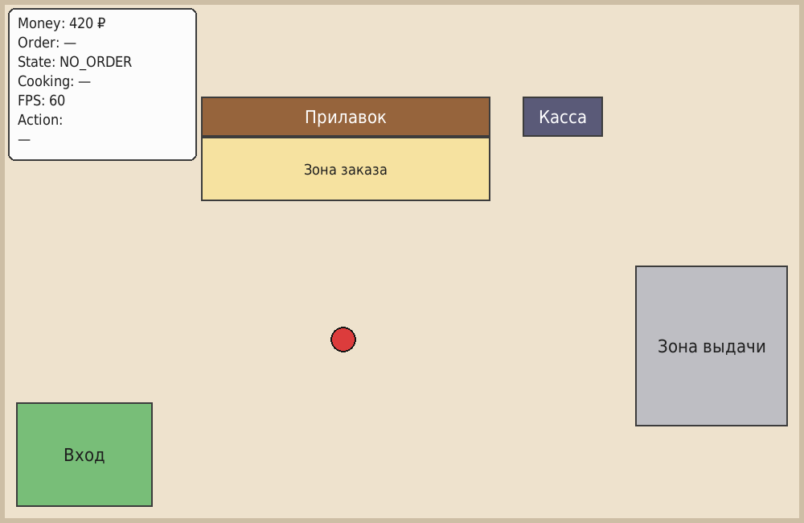
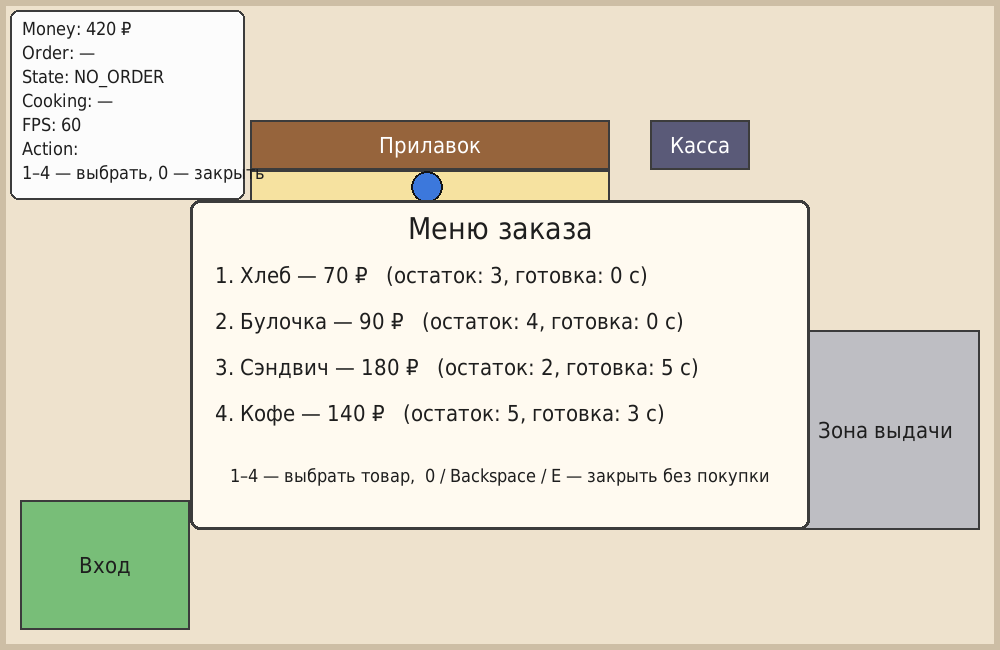

# Симулятор пекарни. Этап 1 — клиент и заказ

Практическая работа на **PyGame**. Клиент (круг) ходит по 2D-плану пекарни, оформляет заказ у прилавка
и забирает его в зоне выдачи.

**Автор:** Ожиганова Анастасия Павловна, группа ДЭ-24-24

## Скриншоты

| Общий вид пекарни | Меню заказа |
|---|---|
|  |  |

## Запуск

```bash
pip install -r requirements.txt
python main.py
```

Требуется Python 3.9+.

## Управление

| Клавиша | Действие |
|---|---|
| `W` `A` `S` `D` | движение клиента (английская раскладка) |
| `SPACE` | сменить цвет клиента |
| `E` | сделать заказ у прилавка / получить заказ в зоне выдачи |
| `1`–`4` | выбрать товар в меню |
| `0` / `Backspace` | закрыть меню без покупки |
| `Esc` | выход |

## Структура проекта

```text
practice_02/
├── main.py                 # приложение целиком
├── demo_screenshots.py     # сценарий для автоматических скриншотов (без окна)
├── requirements.txt
├── README.md
└── screenshots/
    ├── bakery.png
    └── ordering.png
```

## Основные программные решения

- **Цикл и FPS.** `pygame.time.Clock().tick(60)` ограничивает частоту кадров и возвращает время кадра;
  оно переводится в секунды (`dt`) и используется для движения и таймера готовки.
- **Движение.** Скорость хранится в пикселях в секунду (`220 px/s`), смещение = `скорость * dt`.
  Вектор направления нормализуется (делится на `hypot(dx, dy)`), поэтому диагональ не быстрее движения по оси.
- **Столкновения.** Прилавок и касса — `pygame.Rect` в списке `OBSTACLES`. Пересечение круга с
  прямоугольником проверяется по ближайшей точке прямоугольника. Оси X и Y проверяются раздельно,
  поэтому клиент скользит вдоль препятствия. Границы окна ограничиваются через `min`/`max`.
- **Смена цвета.** Используется событие `KEYDOWN`: оно приходит один раз на нажатие, а не при удержании.
- **Данные.** Товары — список словарей (`name`, `price`, `stock`, `cook_time`); всё состояние игры
  (деньги, заказ, меню, сообщения) хранится в одном словаре `state`.
- **Заказ.** `try_order()` сначала проверяет остаток, затем деньги. При успехе списывает деньги и
  уменьшает остаток. Состояния: `NO_ORDER → WAITING → READY → DONE`. Активный заказ один:
  пока он не получен, меню не открывается.
- **Приготовление без `time.sleep`.** В `update_order()` из `cook_left` каждый кадр вычитается `dt`.
  Цикл не блокируется, клиент двигается во время готовки. Когда таймер доходит до 0, заказ становится `READY`.
- **Разделение логики и отрисовки.** Деньги, остатки и состояния меняются только в `handle_events`,
  `try_order`, `interact`, `update_order`. Функции `draw_*` только читают `state`.
- **Структура кода.** `main()`, `handle_events()`, `handle_movement()`, `update_order()`,
  `draw_scene()`, `draw_ui()`.
